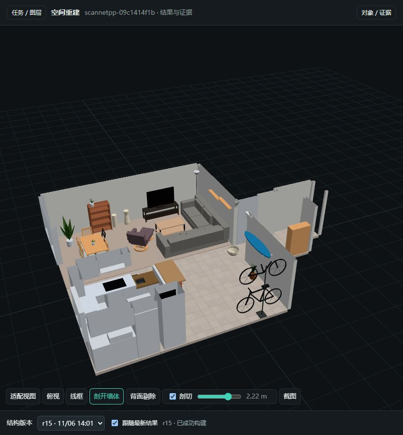

# Restruct

[English](README.md) | [简体中文](README.zh-CN.md)

**Turn indoor scans into editable, structured 3D scenes.**

Restruct turns indoor scans, point clouds and optional calibrated photographs into editable structural models. It provides input validation, evidence queries, perception proposals, parametric modeling, Blender editing and a local GLB viewer. An agent or human still needs to organize and refine walls, openings, stairs and furniture using the available evidence.

**Current versions: core 0.7.7 · Blender add-on 0.3.1 · skill 0.7.7 · model v2.** This is a prerelease toolchain candidate, not a PyPI release. Synthetic examples validate interfaces and delivery workflows; they do not establish reconstruction accuracy on real scans or quality across scenes.



**ScanNet++ example:** r15 retains the corrected r14 geometry and adds photo-based color sampling and 21 procedural PBR materials. All 63 textures passed final export and reopen checks. This is an actual viewer screenshot with walls cut away to show the interior; furniture shapes, some materials and occluded areas remain approximate. See the [case record](cases/scannetpp-09c1414f1b/README.md) for provenance, validation and limitations. Raw data and downloadable models are not distributed with this repository.

<a id="快速开始"></a>

## Quick start

Use Python 3.11–3.12. Install Blender separately; the current integration validation uses 5.1.2. After cloning `HomeSpatial/restruct`, run these commands from the repository root:

```bash
python -m venv .venv
# Activate the environment: Linux/macOS: source .venv/bin/activate
# Windows PowerShell: .venv/Scripts/Activate.ps1
python -m pip install ".[geometry]"
restruct --help
```

The project is **Restruct**, the Python distribution is `homespatial-restruct`, the command is `restruct`, and the Python module is `indoor_recon`. Install from source for now; there is no PyPI release of this project. The existing `restruct` package on PyPI is a different project.

The following examples use **COLMAP data** and an **RTAB-Map database**. First follow [input preparation](docs/input-data.md) to obtain photographs, cameras and dense geometry, and establish units and the up axis. Copy the [runtime example](config/runtime.example.json) to `runtime.local.json`, then follow the [backend guide](docs/backends.md) to configure the required interpreters, source checkouts, weights and Blender path.

**COLMAP: matching dense geometry, photographs and cameras are already available.** This example uses the undistorted `dense/0` workspace and assumes that geometry and cameras are known to use metres with +Z up. Change the declarations if your data uses other units or axes. Purely visual SfM does not automatically recover physical scale.

```bash
restruct import-colmap private/colmap --model-prefix dense/0/sparse --images-prefix dense/0/images --geometry-path dense/0/fused.ply --scene-id colmap-room --up-axis +Z --metres-per-unit 1 --out artifacts/colmap-input
restruct prepare artifacts/colmap-input/scene.json --preflight
restruct init-task artifacts/colmap-input/scene.json --runtime runtime.local.json --labels-file profiles/indoor-fixtures-75.json --out artifacts/colmap-task
```

**RTAB-Map: start with a `.db` that retains RGB images and calibration.** Use a separately installed [rtabmap-hloc](https://github.com/HomeSpatial/rtabmap_hloc) to export cameras and photographs, then [remap](https://github.com/HomeSpatial/remap) to create dense geometry, passing results through the same bundle:

```bash
rtabmap-hloc private/capture.db --bundle artifacts/rtabmap-house
remap reconstruct --bundle artifacts/rtabmap-house --profile native --preflight
remap reconstruct --bundle artifacts/rtabmap-house --profile native
restruct init-task --bundle artifacts/rtabmap-house --runtime runtime.local.json --labels-file profiles/indoor-fixtures-75.json
```

Run each upstream command in its own environment and point it at the same bundle directory. See the [RTAB-Map route](docs/input-data.md#rtab-map-database-route) for installation, access requirements and the difference between `native` and the default profile. `rtabmap-hloc` publishes a sparse model; dense geometry must be added before using it here. If you already have suitable geometry and calibrated photographs, you do not need that tool. Both upstream tools are optional and are not installation dependencies of `restruct`.

These steps complete **input preparation and task initialization**. Follow [task startup](docs/cli.md#create-a-task-from-a-new-scan) to run perception, then use an agent or human review to organize and correct the parameter model from evidence before running `build`, appearance checks and delivery checks. Use a fresh output directory for every run. To check a Blender installation without scans, photographs, a GPU or weights, use the [synthetic room example](docs/quickstart.md).

<a id="重建过程中实时查看"></a>

## Watch reconstruction updates

The viewer compares four layers: the scan, SpatialLM layout, Boxer objects and the structural model. Tasks containing prepared data open in the layered workspace by default. You can filter proposals, inspect source photographs and 2D boxes, expand object parts and switch model revisions. For example, run `restruct view artifacts/colmap-task --open`; see the [viewer guide](docs/viewer.md). The following uses `artifacts/demo` from the [synthetic room example](docs/quickstart.md) to demonstrate following a model-only directory without perception data.

Run this command in another terminal and leave it running. Replace the example directory with your task directory when working on a reconstruction:

```bash
restruct view artifacts/demo --port 8770
```

Open the [live-follow page](http://127.0.0.1:8770/?follow=.) after the server starts. `follow=.` watches the selected directory and its children. The directory must already exist; the page waits if no first build is available. `--open` opens the ordinary browser page; add `?follow=.` to enable following. If the port is occupied, change both `--port` and the browser URL.

On each iteration, the agent runs `restruct build` into a new subdirectory of the task and increments the model's `revision`. The room example produces:

```text
artifacts/demo/
  create/           # revision 1
    build.json
    model.glb
  edited/           # revision 2
    build.json
    model.glb
```

The page checks roughly every **2 seconds** and loads the successful build with the highest revision, without a manual refresh. It preserves the view when switching and briefly highlights added or changed objects. It also shows the current revision, object additions/changes/removals, recent completed tool runs and their success/failure status. Related residual or geometry reports add diagnostic summaries.

**Updates are model snapshots after each successful build.** The viewer accepts results only when `build.json` reports success and `model.glb` exists in the same directory. It continues displaying the previous revision while parameters are being edited, inference is running or Blender is building. Editing JSON alone, or editing in Blender without exporting, does not update the page. Model loading adds to the visible update delay.

While viewing, you can orbit, zoom, switch to a top view, cut away walls, clip by height, toggle categories or overlay a second model. Keep revisions of one scene in each task directory. Remote or container jobs must mount or synchronize outputs into a directory the viewer can read.

| Mode | Open after starting the server |
| --- | --- |
| Follow the latest result | [Live follow](http://127.0.0.1:8770/?follow=.) |
| Replay revisions in order, holding each for 4 seconds | [Revision replay](http://127.0.0.1:8770/?replay=.&hold=4) |
| Select a model and comparison model manually | [Browse models](http://127.0.0.1:8770/) |

Revision replay supports Space to pause and the arrow keys to step. To replay evidence images and commentary alongside the models, see [activity records and process replay](docs/cli.md#activity-records-and-process-replay).

<a id="能力与使用边界"></a>

## Capabilities and limits

- **Inputs and coordinates:** meshes, point clouds, calibrated RGB-D, COLMAP and independent reconstruction/bundle handoff, with units, axes, asset hashes and provenance.
- **Evidence queries:** photo projections, rays, point-cloud slices, local planes and appearance sampling; model diagnostics locate missing surfaces, offsets, excess geometry and intersections.
- **Parametric modeling:** shared wall/floor/ceiling vertices, hosted openings, furniture parts and individual stair steps, with stable object IDs and revisions in editable Blender projects and standard GLB files.
- **Local viewing:** bundled offline three.js, live build following, category visibility, clipping, wireframe, overlays, revision replay and process replay.
- **Optional perception:** SpatialLM and Boxer run in separate external environments. Their source and weights retain their own licenses, including noncommercial restrictions for some components.

The tool does not automatically guarantee indoor topology, reconstruction completeness, physical accuracy or navigability. Occlusion, glass, missed or false detections and scan noise need scene-specific review. Real scans and weights are not included in the source. The current real-scene showcase is the corrected ScanNet++ PBR case; see the [case and sample policy](cases/README.md). Its screenshots and validation records do not establish quality across scenes.

<a id="安装-spatiallm-和-boxer"></a>

## Install SpatialLM and Boxer

For GPU perception, follow the [backend download, configuration and verification guide](docs/backends.md) to obtain official source and weights, then choose containers or separate Python environments. Boxer needs BoxerNet, DINOv3 and OWL-V2 weights. SpatialLM needs a complete model directory, including configuration and tokenizer files.

The defaults retain the source, weights and dependency combinations previously validated by this project. You may select other commits/tags, model directories and checkpoint files. Custom versions are marked unverified; actual interface or loading failures block execution. Match extension dependencies when changing PyTorch/CUDA. See the [backend manifest](src/indoor_recon/backends.json) for defaults.

After configuring `runtime.local.json`, check the configuration and then run a separate minimal inference check:

```bash
restruct verify-backends --runtime runtime.local.json --labels-file profiles/indoor-fixtures-75.json --level config --out artifacts/backend-config
restruct verify-backends --runtime runtime.local.json --labels-file profiles/indoor-fixtures-75.json --level smoke --out artifacts/backend-smoke
```

Use a fresh output directory each time. `config` does not start a model; `imports` checks interfaces, GPU support and vocabulary; `load` loads weights; `smoke` also runs a forward pass on synthetic input. If only one backend is installed, add `--backend spatiallm` or `--backend boxer`. Passing verification does not establish real-scene quality.

<a id="文档"></a>

## Documentation

| Task | Guide |
| --- | --- |
| Installation and synthetic room | [Quick start](docs/quickstart.md) |
| Obtain COLMAP / RTAB-Map inputs | [Input data and upstream tools](docs/input-data.md) |
| Download, select and verify SpatialLM / Boxer | [Backend setup](docs/backends.md) |
| Watch the latest reconstruction | [Live updates](#watch-reconstruction-updates) |
| Import, prepare, predict and initialize tasks | [CLI](docs/cli.md) · [Independent data handoff](docs/exchange-workflow.md) |
| Data and parameter formats | [Data and coordinate contracts](docs/contracts.md) · [Parameter scenes](docs/scene-model.md) |
| Query and diagnose evidence | [Evidence tools](docs/evidence.md) |
| Blender API and installation ZIP | [Add-on guide (Chinese)](blender/README.md) |
| Agent reconstruction method | [Reconstruction skill (Chinese)](skills/reconstruct-structured-interiors/SKILL.md) |
| Contribute, test and release | [Contributing](CONTRIBUTING.md) · [Testing](docs/testing.md) · [Releasing](docs/releasing.md) |
| Version history | [Changelog](CHANGELOG.md) |

Install `python -m pip install ".[geometry]"` for scan preparation. Configure [runtime bindings](config/runtime.example.json) or use the [optional container build (Chinese)](containers/README.md) when GPU perception is needed. The source and wheel do not include perception backends or weights, and there is no official public GPU image.

Whole-house reconstruction includes appearance sampling, procedural PBR, matched photo/render review and export checks by default. `init-task` writes these steps into `STATE.md` and generates `check_materials_prefix`. Final and reopened exports must pass `restruct check-materials`; see the [default appearance workflow (Chinese)](skills/reconstruct-structured-interiors/references/blender-materials.md#默认外观流程). A successful intermediate geometry build does not mean whole-house delivery is complete.

The maintained skill source is in `skills/reconstruct-structured-interiors/`. For a first installation, run:

```bash
python -B scripts/sync_skill.py --target /path/to/codex/skills/reconstruct-structured-interiors
```

To update an existing copy, add `--backup /new/path/skill-before`; use `--check` to compare. Custom UI/policy settings and additional files are preserved and reported.

<a id="许可"></a>

## License

Core code, documentation, general scripts and the skill use [Apache-2.0](LICENSE). `blender/` uses [GPL-3.0-or-later](blender/LICENSE); the shared core parameter module packaged in the add-on retains Apache-2.0. three.js retains MIT. External code, dependencies and weights retain their own terms; see the [complete license boundaries](THIRD_PARTY_NOTICES.md).
