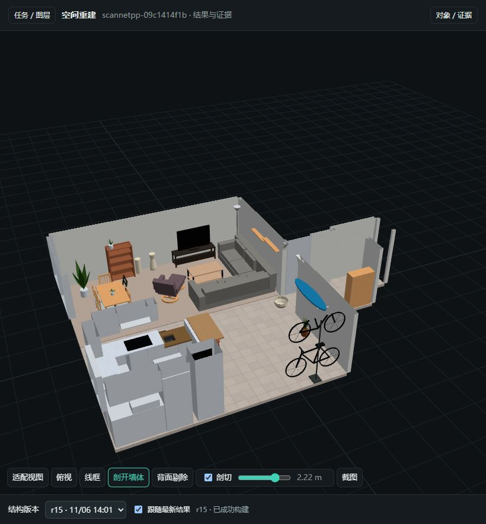

# Restruct

[English](README.md) | [简体中文](README.zh-CN.md)

**Turn indoor scans into editable, structured 3D scenes.**

把室内扫描、点云和可选的标定照片整理为可编辑的结构模型。工具提供输入验证、证据查询、候选感知、参数建模、Blender 编辑与 GLB 本地查看；最终墙体、门窗、楼梯和家具仍需要 Agent 或人工依据证据组织和修正。

**当前：核心 0.7.7 · Blender 插件 0.3.1 · skill 0.7.7 · model v2。** 这是工具链预发布候选，尚未发布到 PyPI。合成示例验证接口和交付流程，不代表真实扫描精度或跨场景质量验收。



**ScanNet++ 实例：** 修正版 r14 几何保留，r15 补齐照片取色与 21 套程序化 PBR；63 张贴图通过最终导出和重开检查。上图为实际查看器截图，墙体已剖切以展示室内；家具造型、部分材质与遮挡区域仍有近似。来源、验证结果和限制见[案例记录](cases/scannetpp-09c1414f1b/README.md)。原始数据与可下载模型不随仓库分发。

## 快速开始

Python 3.11–3.12；Blender 单独安装，当前集成验证使用 5.1.2。克隆 `HomeSpatial/restruct` 后，在仓库根目录执行：

```bash
python -m venv .venv
# 激活环境：Linux/macOS: source .venv/bin/activate
# Windows PowerShell: .venv/Scripts/Activate.ps1
python -m pip install ".[geometry]"
restruct --help
```

项目名为 **Restruct**，Python 分发包名为 `homespatial-restruct`，命令为 `restruct`，Python 模块为 `indoor_recon`。当前从源码安装，尚无 PyPI 发行版；PyPI 上已有的 `restruct` 是另一个项目。

以 **COLMAP 数据**和 **RTAB-Map 数据库**作为两种输入示例。先按[输入数据准备](docs/input-data.zh-CN.md)取得照片、相机和稠密几何，并确认单位与朝上方向。复制 [runtime 配置](config/runtime.example.json) 为 `runtime.local.json`，按[后端指南](docs/backends.zh-CN.md)填写所用后端的解释器、源码、权重及 Blender 路径。

**COLMAP：已有匹配的稠密几何、照片和相机。** 下例采用去畸变后的 `dense/0` 工作目录，假设几何和相机已确认是米制、+Z 朝上；实际单位和轴向不同需修改声明。原始纯视觉 SfM 不自动具有真实尺度。

```bash
restruct import-colmap private/colmap --model-prefix dense/0/sparse --images-prefix dense/0/images --geometry-path dense/0/fused.ply --scene-id colmap-room --up-axis +Z --metres-per-unit 1 --out artifacts/colmap-input
restruct prepare artifacts/colmap-input/scene.json --preflight
restruct init-task artifacts/colmap-input/scene.json --runtime runtime.local.json --labels-file profiles/indoor-fixtures-75.json --out artifacts/colmap-task
```

**RTAB-Map：从保留 RGB 和标定的 `.db` 开始。** 使用单独安装的 [rtabmap-hloc](https://github.com/HomeSpatial/rtabmap_hloc) 导出相机和照片，再用 [remap](https://github.com/HomeSpatial/remap) 生成稠密几何，通过同一个 bundle 交接：

```bash
rtabmap-hloc private/capture.db --bundle artifacts/rtabmap-house
remap reconstruct --bundle artifacts/rtabmap-house --profile native --preflight
remap reconstruct --bundle artifacts/rtabmap-house --profile native
restruct init-task --bundle artifacts/rtabmap-house --runtime runtime.local.json --labels-file profiles/indoor-fixtures-75.json
```

上游命令在各自环境执行，并指向同一 bundle 目录；安装、访问要求和 `native`／默认 profile 的区别见 [RTAB-Map 路线](docs/input-data.zh-CN.md#rtab-map-数据库路线)。`rtabmap-hloc` 发布的是稀疏模型，需要补齐稠密几何才能进入本项目；已有通用几何和标定照片时无需安装它。两者均为可选上游工具，不是 `restruct` 的安装依赖。

以上步骤完成**输入准备和任务初始化**。后续按 [任务启动说明](docs/cli.zh-CN.md#从新扫描创建任务)执行感知，并由 Agent／人工依据证据组织和修正参数模型，再运行 `build`、外观和交付检查。每次使用新的输出目录。只想确认 Blender 安装时，可运行无需扫描、照片、GPU 或权重的[合成房间示例](docs/quickstart.zh-CN.md)。

## 重建过程中实时查看

查看器支持扫描、SpatialLM 布局、Boxer 物体和结构模型四层对照。包含 prepared 数据的任务默认打开分层工作区，可筛选候选、查看来源照片与二维框、展开对象部件和切换结构版本；例如 `restruct view artifacts/colmap-task --open`，详见[查看器指南](docs/viewer.zh-CN.md)。下面以[合成房间示例](docs/quickstart.zh-CN.md)的 `artifacts/demo` 介绍不含感知数据的纯模型目录跟随方式。

另开一个终端执行下面的命令并保持运行；这里使用上面的示例目录，实际重建时替换为当前任务目录：

```bash
restruct view artifacts/demo --port 8770
```

启动后打开 [实时跟随页面](http://127.0.0.1:8770/?follow=.)。`follow=.` 表示跟随所选目录及其子目录；目录需要已存在，首版尚未构建时页面会显示等待。`--open` 只打开普通浏览页，需要在地址中添加 `?follow=.` 才会自动跟随。端口被占用时修改 `--port`，同时修改浏览器地址中的端口。

Agent 每轮通过 `restruct build` 将结果保存到任务下的新子目录，并递增模型的 `revision`。例如上面的房间示例会产生：

```text
artifacts/demo/
  create/           # revision 1
    build.json
    model.glb
  edited/           # revision 2
    build.json
    model.glb
```

页面约每 **2 秒**检查一次，加载版本号最高的成功构建，无需手动刷新。切换时保留观察视角，新增或修改的对象会短暂标出；还可看到当前版本、对象增删改数量、最近完成的工具运行及成功/失败状态。有对应的残差或几何检查报告时，页面会补充诊断摘要。

**更新粒度是每轮成功构建后的模型快照。** 查看器只接收 `build.json` 标记通过且同目录存在 `model.glb` 的结果。修改参数、推理或 Blender 构建尚未结束时继续显示上一版；只修改 JSON 或在 Blender 中编辑但未导出，不会触发网页更新。模型加载时间会增加可见更新的延迟。

查看过程中可以旋转、缩放、俯视、剖开墙体、按高度剖切、按类别显隐，或叠加第二个模型比较。建议每个任务目录只放一个场景的版本；远端或容器任务需将输出挂载或同步到查看器可读取的目录。

| 查看方式 | 启动服务后打开 |
| --- | --- |
| 自动跟随最新结果 | [实时跟随](http://127.0.0.1:8770/?follow=.) |
| 按版本顺序回放，每版停留 4 秒 | [版本回放](http://127.0.0.1:8770/?replay=.&hold=4) |
| 手动选择模型和对比模型 | [普通浏览](http://127.0.0.1:8770/) |

版本回放支持空格暂停、左右方向键切换；若要连同证据图和说明一起回看，见 [运行记录与过程回放](docs/cli.zh-CN.md#运行记录与过程回放)。

## 能力与使用边界

- **输入与坐标：** 网格、点云、标定 RGB-D、COLMAP，以及独立 reconstruction/bundle 交接；记录单位、轴向、资产哈希和来源。
- **证据查询：** 照片投影、射线、点云薄层、局部平面、外观取色；模型诊断找缺面、偏移、过量几何和穿插。
- **参数建模：** 共享墙地顶节点、宿主门窗、家具部件、逐级楼梯；稳定对象 ID 和 revision，保存在可编辑 Blender 工程与标准 GLB 中。
- **本地查看：** 离线 three.js、实时跟随构建、类别显隐、剖切、线框、模型叠加、版本和过程回放。
- **可选感知：** SpatialLM / Boxer 在各自外部环境中运行；源码和权重保留各自许可，部分含非商业限制。

工具不会自动保证室内拓扑、完整重建、物理精度或导航可通行。扫描遮挡、玻璃、漏检、误检与噪声需逐场景核查。真实扫描和模型权重不包含在源码中；当前真实场景展示采用 ScanNet++ 修正版 PBR 案例，见 [案例与样例政策](cases/README.md)。案例附结果截图与验证记录，不代表跨场景质量验收。

## 安装 SpatialLM 和 Boxer

需要 GPU 感知时，按 [后端下载、配置与验证指南](docs/backends.zh-CN.md) 下载官方源码和权重，再选择容器或独立 Python 环境。Boxer 需要 BoxerNet、DINOv3、OWL-V2 三份权重；SpatialLM 需要完整模型目录（含配置与 tokenizer）。

默认保留已验证的源码、权重与依赖组合，也允许指定其他 commit/tag、模型目录和 checkpoint 文件。自选版本标记为待验证；实际接口或加载失败才阻止运行。更换 PyTorch/CUDA 时需匹配扩展依赖，具体默认值见 [后端清单](src/indoor_recon/backends.json)。

配置好 `runtime.local.json` 后，可先检查，再执行独立的最小推理验证：

```bash
restruct verify-backends --runtime runtime.local.json --labels-file profiles/indoor-fixtures-75.json --level config --out artifacts/backend-config
restruct verify-backends --runtime runtime.local.json --labels-file profiles/indoor-fixtures-75.json --level smoke --out artifacts/backend-smoke
```

每次使用新输出目录。`config` 不启动模型；`imports` 检查接口、GPU 与词表；`load` 加载权重；`smoke` 额外执行合成输入的前向计算。只安装一个后端时增加 `--backend spatiallm` 或 `--backend boxer`。验证通过不代表真实扫描质量已验收。

## 文档

| 需求 | 入口 |
| --- | --- |
| 安装和合成房间 | [快速入门](docs/quickstart.zh-CN.md) |
| 获取 COLMAP / RTAB-Map 输入 | [数据准备与上游工具](docs/input-data.zh-CN.md) |
| SpatialLM / Boxer 下载、版本选择、验证 | [后端安装指南](docs/backends.zh-CN.md) |
| 重建时查看最新结果 | [实时查看](#重建过程中实时查看) |
| 导入、预处理、感知、任务启动 | [CLI](docs/cli.zh-CN.md) · [独立数据交接](docs/exchange-workflow.zh-CN.md) |
| 数据与参数格式 | [坐标和数据契约](docs/contracts.zh-CN.md) · [参数场景](docs/scene-model.zh-CN.md) |
| 查询与诊断 | [证据工具](docs/evidence.zh-CN.md) |
| Blender API 和安装 ZIP | [插件说明](blender/README.md) |
| Agent 重建方法 | [重建 skill](skills/reconstruct-structured-interiors/SKILL.md) |
| 贡献、测试、发布 | [贡献指南](CONTRIBUTING.md) · [测试](docs/testing.zh-CN.md) · [发布](docs/releasing.zh-CN.md) |
| 历史版本 | [CHANGELOG](CHANGELOG.md) |

扫描预处理安装 `python -m pip install ".[geometry]"`。需要 GPU 感知时再配置 [runtime](config/runtime.example.json) 或使用 [可选容器构建](containers/README.md)。默认源码和 wheel 不附带感知后端或权重，也没有官方公共 GPU 镜像。

整屋重建默认包含外观取色、程序化 PBR、同视角照片／渲染复核和导出检查。`init-task` 将这些步骤写入 `STATE.md`，并生成 `check_materials_prefix`；最终及重开导出须通过 `restruct check-materials`，参见 [默认外观流程](skills/reconstruct-structured-interiors/references/blender-materials.md#默认外观流程)。中间几何 build 成功不表示整屋交付完成。

skill 的维护源位于 `skills/reconstruct-structured-interiors/`。首次安装可运行：

```bash
python -B scripts/sync_skill.py --target /path/to/codex/skills/reconstruct-structured-interiors
```

更新已有副本时添加 `--backup /new/path/skill-before`；用 `--check` 核对。自定义 UI/policy 或额外文件会被保留并报告。

## 许可

核心、文档、通用脚本和 skill 采用 [Apache-2.0](LICENSE)；`blender/` 采用 [GPL-3.0-or-later](blender/LICENSE)。插件内打包的核心参数模块保留 Apache-2.0。three.js 保留 MIT；第三方代码、依赖和权重保留各自条款，见 [完整许可边界](THIRD_PARTY_NOTICES.md)。
