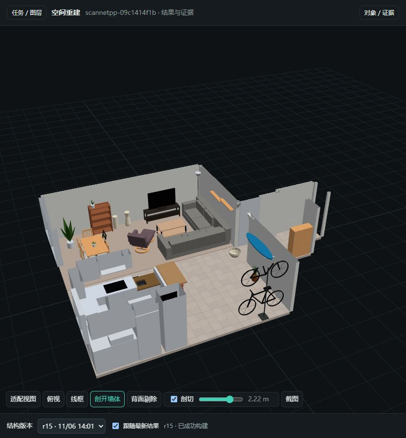

# ScanNet++ 09c1414f1b · corrected geometry and PBR

Recorded 2026-11-06 with core/skill 0.7.7 and Blender addon 0.3.1. This local case
keeps the corrected whole-house r14 geometry and adds r15 appearance and
validation. It is an existing-case continuation, not a fresh perception run or
a dataset benchmark result.



This is an actual screenshot of the authored parameter model in the local viewer,
with walls sectioned to expose the interior. It contains no source photograph or
scan overlay. It illustrates the result, including simplified furniture; it is
not a photometric or geometric accuracy certificate.

## Source and access

[ScanNet++](https://scannetpp.mlsg.cit.tum.de/scannetpp/) by Chandan Yeshwanth,
Yueh-Cheng Liu, Matthias Nießner and Angela Dai, ICCV 2023. Access is governed by
the [ScanNet++ Terms of Use](https://scannetpp.mlsg.cit.tum.de/scannetpp/static/scannetpp-terms-of-use.pdf).
This record includes one result screenshot; it does not redistribute source
data, downloadable derived meshes, source images, camera data or textures. The
screenshot is a research-result illustration, not an Apache-2.0 grant over
ScanNet++ data or dataset-derived content. The local input predates this
case; an upstream release tag was not independently verified, so the scene ID
and immutable input hashes identify the snapshot.

Input scan SHA256:
`d91ae4cb93c5eba7d77ef118b71f4277fb99698e6b7c8afb77393f38cdc8ffc8`.
The bound 841-frame input contains 397 iPhone frames and 444 scan renders.
Appearance queries use only the iPhone subset. Geometry, camera conventions and
source hashes are pinned by the local scene/frames, startup and evidence files.

## Local result and selection

All following paths are relative to the repository root:

```text
artifacts/case-scannetpp-09c1414f1b-077-20261106/
  REPORT.md                       # complete findings and retained limitations
  STATE.md                        # current accepted scope and coverage
  startup.json                    # source, runtime and asset roots
  history/model-r15.json           # editable parameter source
  history/build-r15-pbr/           # blend, glb and project metadata
  appearance-r15/                 # evidence, adoption, 21 texture sets
  authoring/                      # local generation/verification scripts
  validation/final-review.json    # bound comparison and viewer results
  delivery-manifest.json          # final artifact hashes
```

The baseline is r14 from
`artifacts/wholehouse-09-skill071-continue-astra-medium-20261029-b/jobs/task`.
Its GLB SHA256 is
`fe2a7751b6d60c4295c387ce00c4019bf441caef3d2f70b8e04e6ff5b4a4b275`.
The early r18/local-closure branch was rejected after current diagnostics still
reported chair interference and widespread category problems. Diagnostic files
named `baseline-*` in the local case refer to that rejected branch; accepted
r14 comparisons are separately named.

The final r15 GLB SHA256 is
`abeb41ac84cbe5058e2af398a7ec6e65255ffe298a25c1b452607b8d5e5f1662`.
It has 483 rendered meshes and 7062 triangles. Canonical per-object triangle
coordinates differ by 0 m from r14 and from the fresh Blender reopen export.
The parameter file has 497 objects including non-rendering structural data.

## Appearance and validation

- 21 procedural PBR sets, 63 embedded images; 373 textured mesh primitives.
- Base colour, roughness, normal references, UVs and source pixels pass
  `check-materials` on both final and reopened exports. Five uniform material
  exceptions are individually justified, covering glass, screens, uniform
  metal, black coating and simplified leaves.
- Fixed camera comparisons use source frames 449, 511 and 701; r14/r15 overview
  renders share a camera. Tile pitch of about 0.31 m has photo-ray support.
- Current geometry diagnostics: 0 furniture interference, 0 embedded furniture,
  0 semantic warnings; 22 architectural junction and 20 coplanar candidates
  remain documented. This is not a global geometry-quality certificate.
- Scan-area coverage within 2/5/10 cm: 82.74% / 92.98% / 96.92%; residual and
  excess diagnostics are unchanged from the accepted baseline. These metrics
  include clutter and soft/transparent surfaces, not just building geometry.

Remaining limitations include six plan-fit translation candidates, faceted soft
furniture, uncertain recess surfaces, two residual clusters without enough
source evidence, and omitted small clutter. Roughness, micro-normals and texture
patterns are inferred. Colour is estimated without a calibrated chart and the
studio render is paler than photographs. The full local report records these
limitations without treating export success as geometric or photometric proof.

## Local replay and viewer

The ignored artifact scripts reproduce the local continuation using its pinned
asset roots; they are not a standalone public downloader. To reproduce on another
machine, obtain authorized data, restore the matching scene/frames and baseline,
then rebind `startup.json`/runtime roots before using the scripts. Use new build
and validation output directories after edits.

The sequence is: source subset and appearance queries → accepted/rejected colour
choices → procedural texture recipes and model r15 → build → `check-materials`
and unchanged-geometry comparison → fresh-process reopen/rebuild/export →
`check-materials` again → same-camera render and browser inspection.

```bash
restruct view artifacts --port 8791
```

The local registry `artifacts/viewer-tasks.local.json` maps
`@case-scannetpp-09c1414f1b` to the original prepared task and this case's history.
Open `http://127.0.0.1:8791/?task=%40case-scannetpp-09c1414f1b`.
The verified workspace includes r14/r15, scan preview, 27 SpatialLM candidates,
93 Boxer candidates and source-photo overlays. The scan layer is a preview of
at most 80000 preprocessed points; validation uses the original bound input.
